<p>
  <picture>
    <source media="(prefers-color-scheme: dark)" srcset="assets/img/logo-white.svg">
    
  </picture>
</p>

# Seyal

**Plan it. Do it. Close the day.**

**Seyal** is a free, open-source, self-hosted project, daily-work and performance management app for teams, written in plain PHP and MySQL.
*Seyal* (செயல், pronounced **SAY-yal**) is the Tamil word for *action* or *work done*.

No Composer, no Node.js, no build step: copy the files, open the browser, follow the installer.

[](LICENSE)


[](https://fluxosoft.com/contact)

Runs on Windows, Linux and macOS — on a laptop, an office server, a VPS or ordinary shared hosting (Hostinger, cPanel and similar).

**Available in 9 languages:** English · हिन्दी (Hindi) · தமிழ் (Tamil) · ಕನ್ನಡ (Kannada) · తెలుగు (Telugu) · മലയാളം (Malayalam) · العربية (Arabic) · Deutsch (German) · Español (Spanish). Every user picks their own language. [See details](#languages).

> 💬 **Need help installing or setting it up?** Send us a message at **[fluxosoft.com/contact](https://fluxosoft.com/contact)** — tell us your operating system or hosting provider and what you've tried, and we'll get back to you.

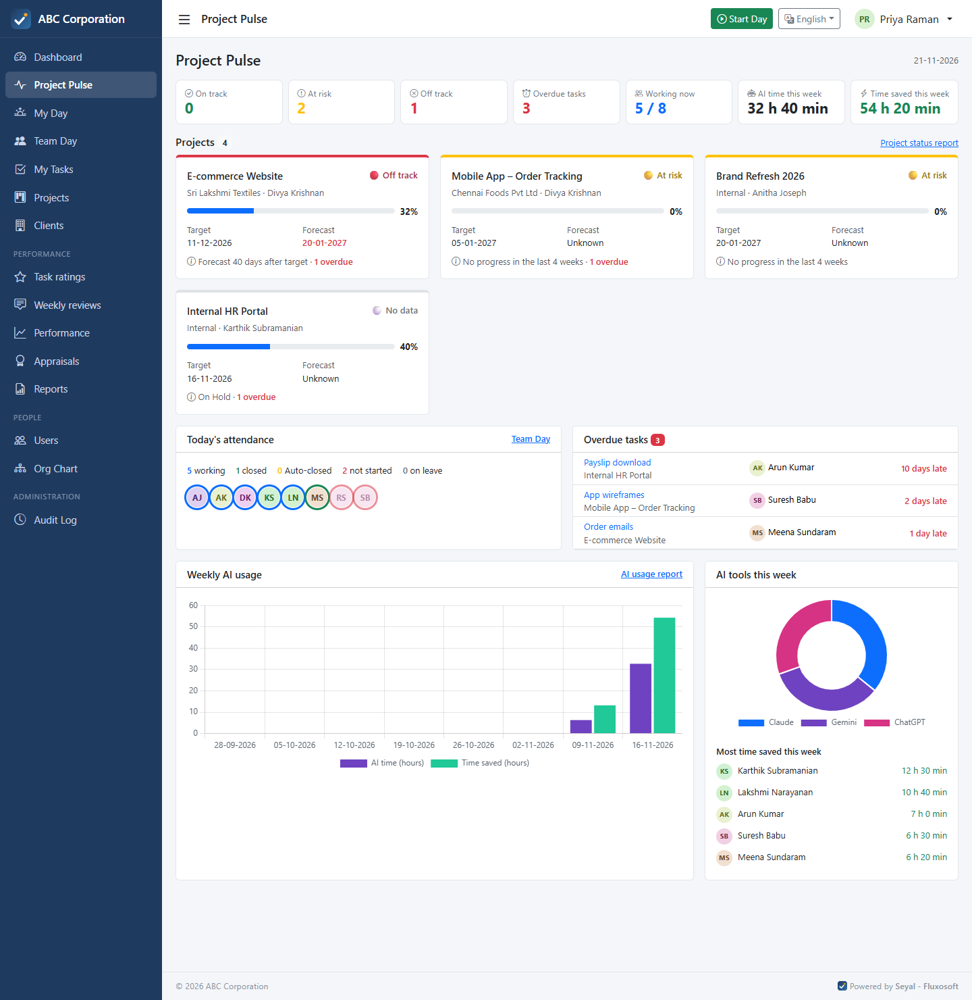

---

## Contents

- [Screenshots](#screenshots)
- [Features](#features)
- [Requirements](#requirements)
- [Quick start (try it in 5 minutes)](#quick-start-try-it-in-5-minutes)
- [Installation](#installation)
  - [1. Get the code](#1-get-the-code)
  - [2. Prepare the database](#2-prepare-the-database)
  - [3. Set up the web server](#3-set-up-the-web-server)
    - [Windows](#windows)
    - [Linux](#linux)
    - [macOS](#macos)
    - [Shared hosting (Hostinger, cPanel)](#shared-hosting-hostinger-cpanel)
  - [4. Run the web installer (database details)](#4-run-the-web-installer-database-details)
  - [5. After installation](#5-after-installation)
- [Scheduler (reminders, digests, backups)](#scheduler-reminders-digests-backups)
- [Email setup](#email-setup)
- [Microsoft Teams setup](#microsoft-teams-setup)
- [Demo data](#demo-data)
- [Upgrading](#upgrading)
- [User guide](#user-guide)
- [Languages](#languages)
- [Security checklist](#security-checklist)
- [Troubleshooting](#troubleshooting)
- [Project structure](#project-structure)
- [Contributing](#contributing)
- [Support](#support)
- [License](#license)
- [Third-party components](#third-party-components)

---

## Screenshots

*All screenshots use the built-in [demo data](#demo-data).*

<table>
  <tr>
    <td width="50%"><a href="docs/screenshots/dashboard.png">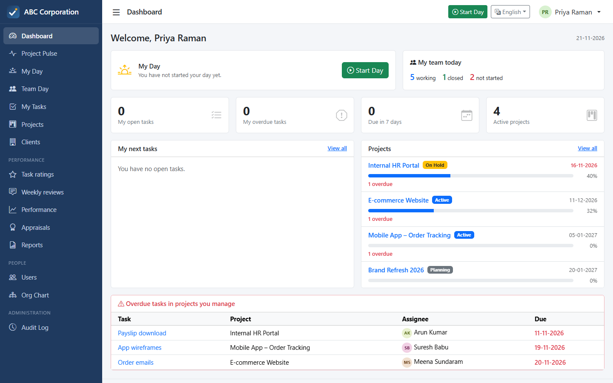</a><br><b>Dashboard</b> — your day, your team today, open and overdue tasks, project progress</td>
    <td width="50%"><a href="docs/screenshots/my-day.png">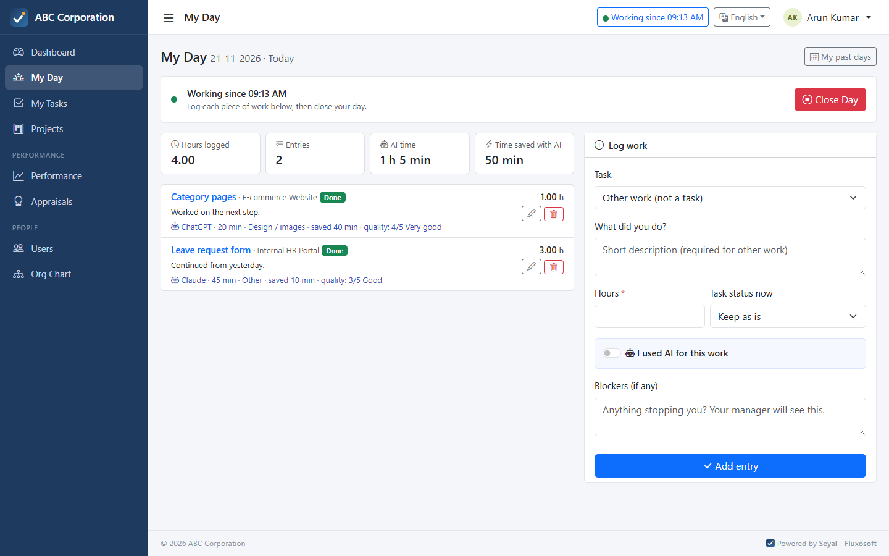</a><br><b>My Day</b> — Start Day, log work per task with AI usage, then Close Day</td>
  </tr>
  <tr>
    <td><a href="docs/screenshots/team-day.png">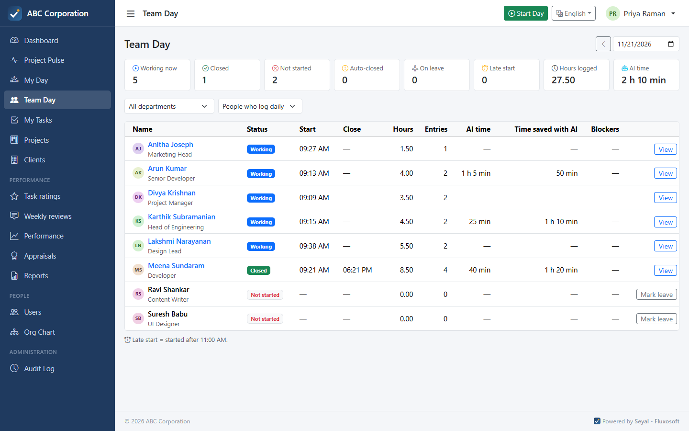</a><br><b>Team Day</b> — who is working, closed or not started, with hours, AI time and blockers</td>
    <td><a href="docs/screenshots/kanban.png">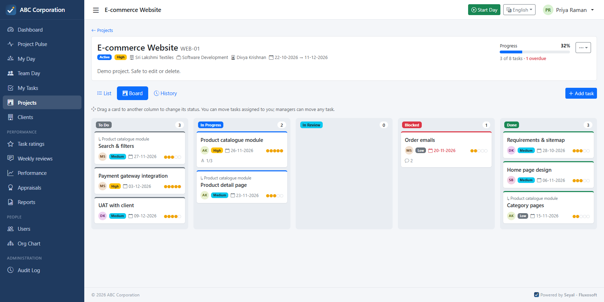</a><br><b>Kanban board</b> — drag-and-drop tasks with priority, due date and weightage</td>
  </tr>
  <tr>
    <td><a href="docs/screenshots/performance.png">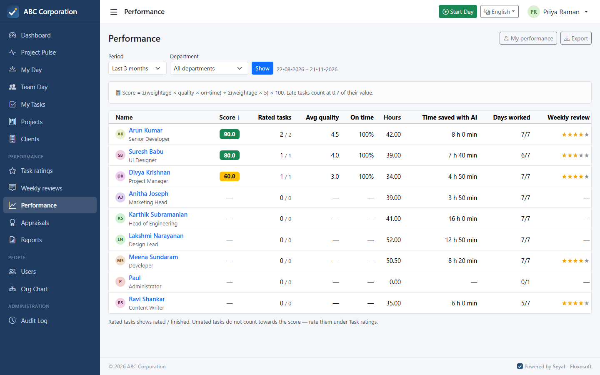</a><br><b>Performance</b> — scores from weightage × quality × on-time, plus hours and AI time saved</td>
    <td><a href="docs/screenshots/org-chart.png">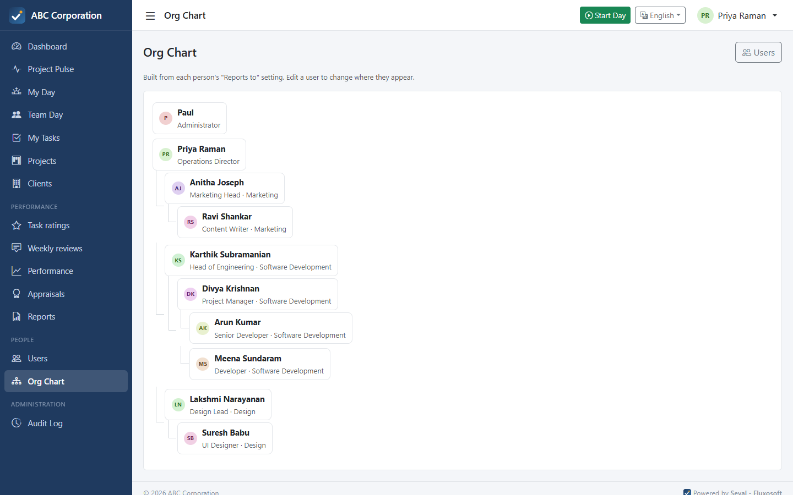</a><br><b>Org chart</b> — built automatically from each person's "Reports to"</td>
  </tr>
  <tr>
    <td><a href="docs/screenshots/tamil-dashboard.png">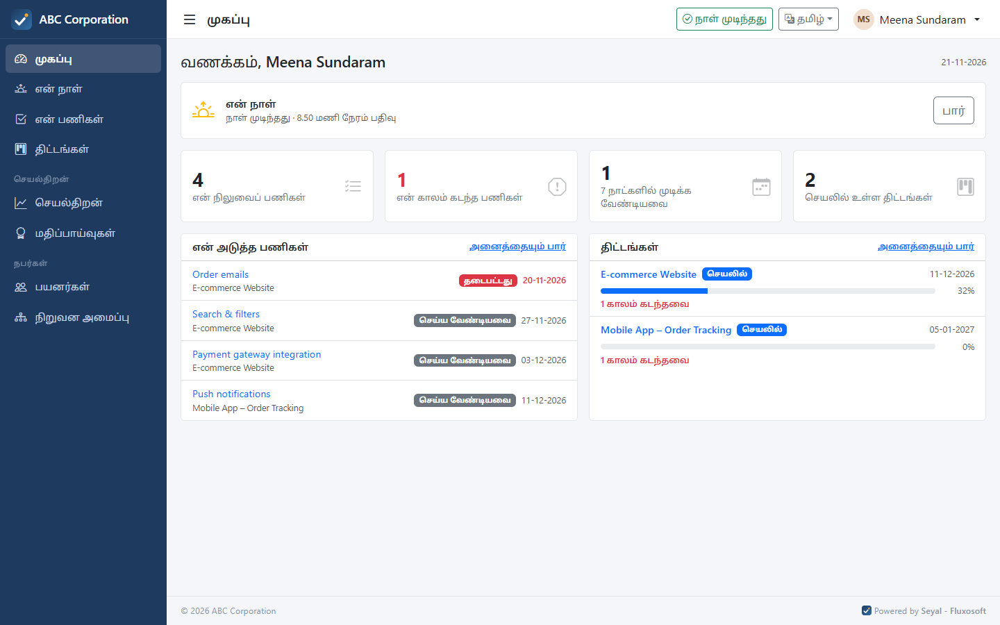</a><br><b>Tamil</b> — every user picks their own language</td>
    <td><a href="docs/screenshots/hindi-dashboard.png">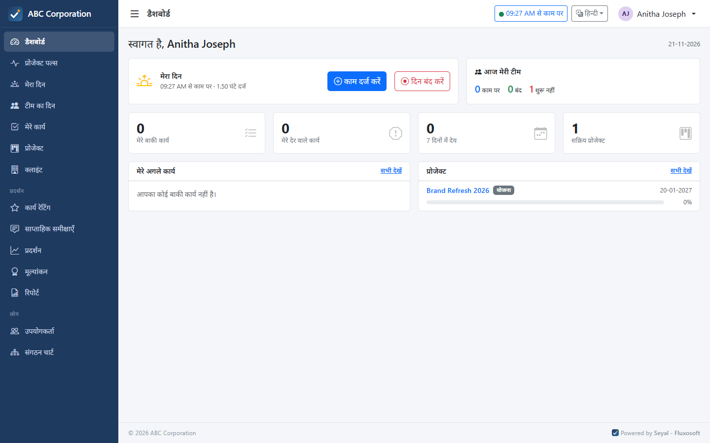</a><br><b>Hindi</b></td>
  </tr>
  <tr>
    <td><a href="docs/screenshots/arabic-dashboard.png">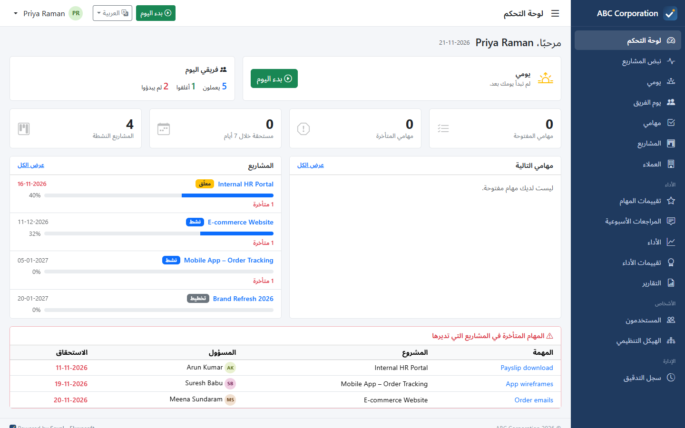</a><br><b>Arabic</b> — full right-to-left layout</td>
    <td><a href="docs/screenshots/spanish-dashboard.png">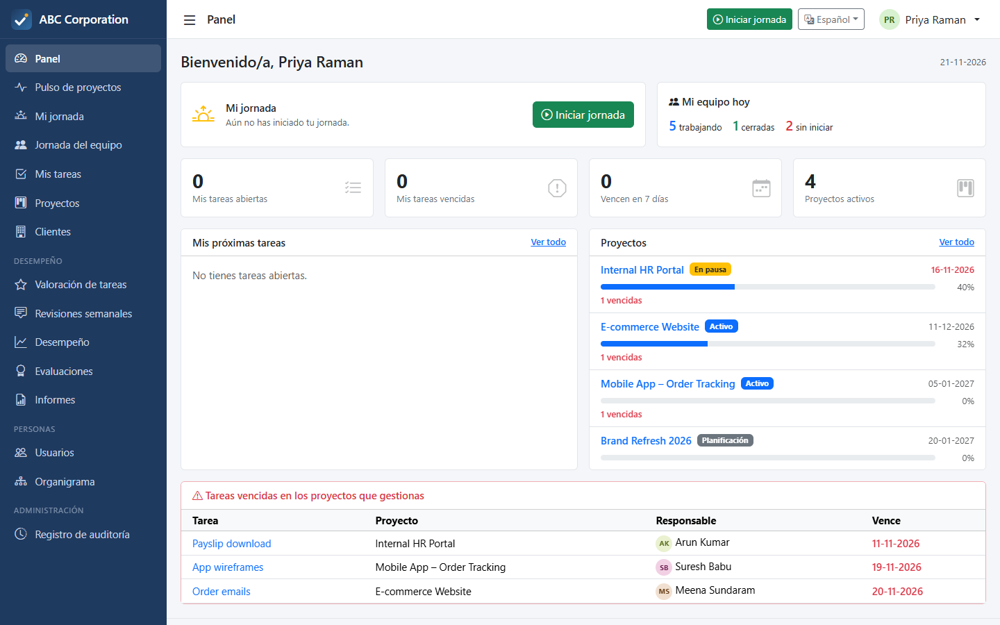</a><br><b>Spanish</b></td>
  </tr>
  <tr>
    <td colspan="2" align="center"><a href="docs/screenshots/mobile-my-day.png">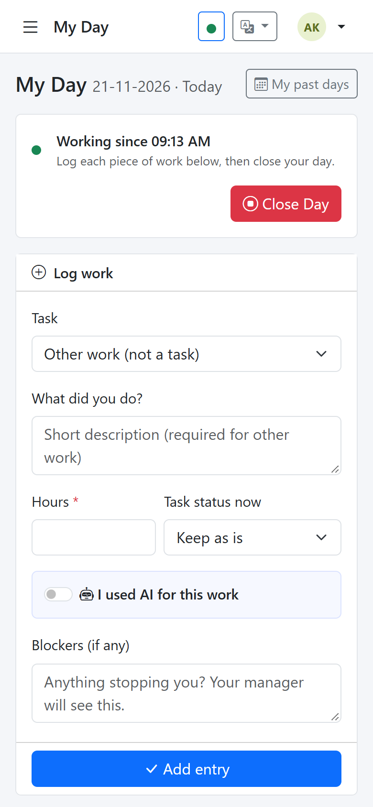</a><br><b>Works on phones</b> — add it to the home screen like an app</td>
  </tr>
</table>

---

## Features

**Projects & tasks**
- Projects → tasks → subtasks with assignee, priority, **weightage (1–5)**, estimated hours, start and due dates
- List view and drag-and-drop **Kanban board**, comments, file attachments
- Clients, or mark a project as *Internal*
- Optional per project: **team members add their own tasks** (always assigned to themselves; only managers assign work to others or set weightage)
- **Audit log** of every change — changing a due date requires a reason

**People & access**
- Users, departments, "Reports to" hierarchy with an **org chart**
- Roles: Super Admin, Senior Management, Department Head, Project Manager / Team Lead, Team Member, Client — with an editable permissions matrix

**Daily work**
- **My Day:** Start Day → log work per task (hours, blockers, **AI usage**: tools, minutes, purpose, time saved, output quality) → **Close Day**
- Close Day summary is emailed to the manager and posted to **Microsoft Teams**
- **Team Day** for managers: who is working, closed, late or not started
- Optional **location at Start Day and Close Day**, shown as map pins in Team Day
- Automatic reminders, manager digests, auto-close and "not started" flags

**Performance**
- **Project Pulse** (management dashboard): 🟢🟡🔴 project health with forecast vs target date, attendance strip, overdue tasks, weekly AI usage charts
- **Task ratings** by the direct manager, **weekly reviews**
- **Performance score** (weightage × quality × on-time) with 12-month trend charts
- **Appraisals:** Draft → Finalised → Published; employees see their score only once published

**And more**
- Read-only **client portal** for your customers
- **Reports** (timesheets, AI usage, project status, performance, attendance) with **Excel / CSV / PDF** export
- One-click and nightly **database backup**
- **9 languages**, including right-to-left Arabic
- Works on phones; **add it to the home screen** and it opens like an app, with its own icon
- Collapsible side menu (icons only, names as tooltips)
- Built-in installer, demo data, update screen, *About* page

---

## Requirements

| Component | Minimum | Notes |
|---|---|---|
| PHP | **8.1** (8.2 / 8.3 recommended) | Extensions: `pdo_mysql`, `mbstring`, `openssl`, `fileinfo`, `zip`, `zlib`. Optional: `curl` (faster Teams posts). |
| Database | **MySQL 5.7+** or **MariaDB 10.3+** | `utf8mb4` is used throughout. |
| Web server | **Apache 2.4** or **LiteSpeed** (uses the bundled `.htaccess` files) — or **Nginx** with the config below | |
| Browser | Any current Chrome, Edge, Firefox or Safari | |
| Disk | ~15 MB for the app, plus space for uploads and backups | |

Check your PHP version and extensions from a terminal:

```bash
php -v
php -m | grep -Ei "pdo_mysql|mbstring|openssl|fileinfo|zip|zlib|curl"
```

(On Windows PowerShell use `php -m | Select-String "pdo_mysql|mbstring|openssl|fileinfo|zip|zlib|curl"`.)

---

## Quick start (try it in 5 minutes)

If you already have **PHP 8.1+** and a **MySQL/MariaDB** server running, you can try the app without configuring a web server:

```bash
git clone https://github.com/siprabin/seyal.git
cd seyal
php -S 127.0.0.1:8000 server.php
```

Open **http://127.0.0.1:8000** and follow the installer ([step 4](#4-run-the-web-installer-database-details)).

> ⚠️ PHP's built-in server is for **trying the app on your own computer only**. It handles one request at a time. `server.php` blocks the private folders that `.htaccess` normally protects, but for real use — and always for anything reachable from other computers — set up Apache, LiteSpeed or Nginx as described below.

---

## Installation

### 1. Get the code

**With git:**

```bash
git clone https://github.com/siprabin/seyal.git
```

**Without git:** on the GitHub page click **Code → Download ZIP** and extract it.

You can install it at the web root (`https://seyal.example.com/`) or in a sub-folder (`https://example.com/seyal/`) — the app detects its own path.

### 2. Prepare the database

The app needs one empty MySQL/MariaDB database and a user that can use it.

> **Shortcut:** if the database user you give the installer has permission to create databases (for example `root` on XAMPP or MAMP), the installer creates the database for you and you can skip this step.

Otherwise, open a MySQL prompt and run the following, choosing your own password:

```bash
# Linux / macOS (Homebrew MariaDB uses your login for root via the socket)
sudo mysql
# Windows (XAMPP): C:\xampp\mysql\bin\mysql.exe -u root -p
```

```sql
CREATE DATABASE seyal CHARACTER SET utf8mb4 COLLATE utf8mb4_unicode_ci;
CREATE USER 'seyal_user'@'localhost' IDENTIFIED BY 'choose-a-strong-password';
GRANT ALL PRIVILEGES ON seyal.* TO 'seyal_user'@'localhost';
FLUSH PRIVILEGES;
```

Write down the four values — you will type them into the installer:

| Value | Example |
|---|---|
| Database name | `seyal` |
| Username | `seyal_user` |
| Password | `choose-a-strong-password` |
| Host / port | `localhost` / `3306` |

You can also do this in **phpMyAdmin** (*Databases → Create database* with collation `utf8mb4_unicode_ci`, then *User accounts → Add user account*) or in your hosting control panel.

### 3. Set up the web server

Pick your platform. Each section ends with the URL to open for [step 4](#4-run-the-web-installer-database-details).

#### Windows

**Option A — XAMPP (recommended)**

1. Download and install **XAMPP** with PHP 8.1 or newer from [apachefriends.org](https://www.apachefriends.org/).
2. Open the **XAMPP Control Panel** and click **Start** for **Apache** and **MySQL**.
3. Copy the project folder to `C:\xampp\htdocs\seyal` (any folder name works).
4. Make sure these PHP extensions are enabled in `C:\xampp\php\php.ini` (remove the leading `;` if present), then restart Apache:
   ```ini
   extension=fileinfo
   extension=mbstring
   extension=openssl
   extension=pdo_mysql
   extension=zip
   ```
5. Optional, for larger attachments, in the same `php.ini`:
   ```ini
   upload_max_filesize = 20M
   post_max_size = 25M
   ```
6. Open **http://localhost/seyal/**

XAMPP's database login is usually user `root` with an **empty password**, host `localhost`, port `3306`.

*To use it from other computers in your office:* allow Apache through Windows Defender Firewall (*Allow an app through firewall → Apache HTTP Server*), find this PC's IP with `ipconfig`, and open `http://<that-IP>/seyal/`.

**Option B — Laragon or WampServer**

Both work the same way: put the folder in the web root (`C:\laragon\www\seyal` or `C:\wamp64\www\seyal`), start Apache + MySQL, enable the extensions above, and open `http://localhost/seyal/`.

**Option C — PHP only (evaluation):** install PHP from [windows.php.net](https://windows.php.net/download/) and MySQL/MariaDB, then use the [Quick start](#quick-start-try-it-in-5-minutes) command.

#### Linux

The examples use **Ubuntu / Debian** and **Apache**; Fedora/RHEL and Nginx follow.

**1. Install the packages**

```bash
sudo apt update
sudo apt install -y apache2 mariadb-server php libapache2-mod-php \
    php-mysql php-mbstring php-xml php-zip php-curl unzip
sudo systemctl enable --now apache2 mariadb
sudo mysql_secure_installation      # recommended
```

**2. Put the app in place**

```bash
sudo git clone https://github.com/siprabin/seyal.git /var/www/seyal
# or: sudo unzip seyal.zip -d /var/www/ && sudo mv /var/www/<extracted-folder> /var/www/seyal
```

**3. Give the web server write access** to the three folders the app writes to:

```bash
cd /var/www/seyal
sudo chown -R www-data:www-data config uploads storage
sudo chmod -R 775 config uploads storage
```

**4. Create the database** as shown in [step 2](#2-prepare-the-database) (`sudo mysql`).

**5. Configure Apache.** Create `/etc/apache2/sites-available/seyal.conf`:

```apache
<VirtualHost *:80>
    ServerName seyal.example.com
    DocumentRoot /var/www/seyal

    <Directory /var/www/seyal>
        AllowOverride All
        Require all granted
    </Directory>

    ErrorLog ${APACHE_LOG_DIR}/seyal-error.log
    CustomLog ${APACHE_LOG_DIR}/seyal-access.log combined
</VirtualHost>
```

`AllowOverride All` is important — the app relies on its `.htaccess` files to keep `config/`, `storage/`, `uploads/` and the source folders private.

```bash
sudo a2ensite seyal
sudo a2enmod headers
sudo a2dissite 000-default      # only if this is the only site on the server
sudo systemctl reload apache2
```

**6. Enable HTTPS** (strongly recommended on any server reachable from the internet):

```bash
sudo apt install -y certbot python3-certbot-apache
sudo certbot --apache -d seyal.example.com
```

**7.** Open **https://seyal.example.com/**

<details>
<summary><b>Fedora / RHEL / Rocky / AlmaLinux</b></summary>

```bash
sudo dnf install -y httpd mariadb-server php php-mysqlnd php-mbstring php-xml php-zip php-curl unzip
sudo systemctl enable --now httpd mariadb
sudo git clone https://github.com/siprabin/seyal.git /var/www/seyal
cd /var/www/seyal
sudo chown -R apache:apache config uploads storage
sudo chmod -R 775 config uploads storage

# SELinux: allow writes to the data folders, and outgoing connections for email and Teams
sudo chcon -R -t httpd_sys_rw_content_t config uploads storage
sudo setsebool -P httpd_can_network_connect 1
```

Create `/etc/httpd/conf.d/seyal.conf` with the same `<VirtualHost>` block as above (log paths `/var/log/httpd/...`), then `sudo systemctl reload httpd`. Open port 80/443 with `sudo firewall-cmd --permanent --add-service={http,https} && sudo firewall-cmd --reload`.
</details>

<details>
<summary><b>Nginx + PHP-FPM</b></summary>

Nginx does not read `.htaccess`, so the private folders must be blocked in the server block:

```nginx
server {
    listen 80;
    server_name seyal.example.com;
    root /var/www/seyal;
    index index.php;
    client_max_body_size 25m;

    # Keep configuration, data and source folders private
    location ~ ^/(app|config|lib|lang|pages|views|storage|uploads|tools|install/migrations)(/|$) { return 404; }
    location ~ (^|/)\. { return 404; }
    location ~ \.(sql|gz|log|md|ini|bak)$ { return 404; }
    location = /server.php { return 404; }

    location / {
        try_files $uri $uri/ /index.php?$query_string;
    }

    location ~ \.php$ {
        include snippets/fastcgi-php.conf;
        fastcgi_pass unix:/run/php/php8.3-fpm.sock;   # adjust to your PHP version
    }
}
```

Install with `sudo apt install nginx php-fpm php-mysql php-mbstring php-xml php-zip php-curl`, set `upload_max_filesize = 20M` and `post_max_size = 25M` in `/etc/php/8.3/fpm/php.ini`, give `www-data` write access to `config uploads storage` as above, then `sudo systemctl reload nginx php8.3-fpm`.
</details>

#### macOS

**Option A — Homebrew (recommended for developers)**

```bash
# 1. Install PHP and MariaDB (installs Homebrew first if needed: https://brew.sh)
brew install php mariadb
brew services start mariadb

# 2. Create a database user (Homebrew's MariaDB lets your macOS account in as root via the socket)
sudo mysql -u root
#    → run the SQL from step 2, then type: exit

# 3. Get the code and run it
git clone https://github.com/siprabin/seyal.git ~/seyal
cd ~/seyal
php -S 127.0.0.1:8000 server.php
```

Open **http://127.0.0.1:8000**. This is fine for one person on one Mac. To share it on your network, use Option B or install Apache with `brew install httpd` and point a virtual host at the folder with `AllowOverride All` (see the Linux Apache example).

**Option B — MAMP or XAMPP for macOS**

1. Install **[MAMP](https://www.mamp.info/)** (or XAMPP for macOS) and start the servers.
2. Copy the folder into the web root: MAMP → `/Applications/MAMP/htdocs/seyal`, XAMPP → `/Applications/XAMPP/htdocs/seyal`.
3. Open `http://localhost:8888/seyal/` (MAMP) or `http://localhost/seyal/` (XAMPP).

MAMP's database login is user `root`, password `root`, host `localhost`, port **`8889`**.

If the installer says a folder is not writable, run in the project folder:

```bash
chmod -R 775 config uploads storage
```

#### Shared hosting (Hostinger, cPanel)

1. **PHP version:** set PHP **8.2 or newer** (Hostinger: *hPanel → Advanced → PHP Configuration*; cPanel: *Select PHP Version* / *MultiPHP Manager*). Make sure `pdo_mysql`, `mbstring`, `fileinfo` and `zip` are ticked.
2. **Database:** create a database and a user and assign the user to the database (Hostinger: *hPanel → Databases → MySQL Databases*; cPanel: *MySQL Database Wizard*). Note the full names — hosts add a prefix such as `u123456789_seyal`.
3. **Upload:** in *File Manager*, open `public_html` (or a sub-folder such as `public_html/seyal`), upload the ZIP and *Extract* it. Make sure the files (`index.php`, `app/`, `install/` …) end up directly in that folder, not in a nested folder.
4. **Permissions:** if needed, set `config/`, `uploads/` and `storage/` (and its sub-folders) to `755`.
5. **SSL:** turn on the free SSL certificate (Hostinger: *Security → SSL*; cPanel: *SSL/TLS Status → Run AutoSSL*).
6. Open `https://yourdomain.com/` (or `/seyal/`).

On shared hosting the database host is almost always **`localhost`**, port **`3306`**.

### 4. Run the web installer (database details)

Open the app's URL. Because it is not installed yet, you are taken to `install/` automatically. The installer has four steps.

**Step 1 — Server check**

Every row must show **OK** (fileinfo is recommended but optional). If a row fails, the message tells you what to fix — usually enabling a PHP extension or making `config/`, `uploads/` or `storage/logs/` writable. Click **Check again** after fixing.

**Step 2 — Database**

| Field | What to enter |
|---|---|
| **Host** | Where MySQL runs. `localhost` for XAMPP, MAMP, Homebrew, most Linux servers and shared hosting. Use the server name or IP for a separate database server. If `localhost` gives *"No such file or directory"*, use **`127.0.0.1`** instead. |
| **Port** | `3306` (MAMP: `8889`). |
| **Database name** | The database from [step 2](#2-prepare-the-database), e.g. `seyal` (on shared hosting the full prefixed name, e.g. `u123456789_seyal`). |
| **Username** | The database user, e.g. `seyal_user` (XAMPP: `root`; MAMP: `root`). |
| **Password** | That user's password (XAMPP: leave empty; MAMP: `root`). |

Click **Test connection** first. It changes nothing and tells you exactly what's wrong:

| Result | Meaning |
|---|---|
| ✅ *Connected … ready to install* | All good — click **Connect & continue**. |
| ⚠️ *Database does not exist yet* | The installer will try to create it. If your user can't create databases, create it first (step 2). |
| ❌ *Wrong username or password* | Check the user and password; on shared hosting include the prefix. |
| ❌ *Cannot reach the server* | MySQL is not running, or the host/port is wrong. |
| ❌ *No access to that database* | Grant the user privileges on the database (step 2, `GRANT …`). |
| ❌ *Already contains this app's tables* | Use an empty database, or remove the old tables first. |

The password is used only to connect and to write `config/config.php`; it is never shown again.

**Step 3 — Company & Super Admin**

Enter your company name, the first administrator's name, email and password (min. 8 characters), the default language and the time zone. Click **Install**. The installer creates all tables and the Super Admin account.

**Step 4 — Finished**

The database details are saved in **`config/config.php`** together with a random secret key used to encrypt stored passwords (SMTP, Teams). Keep this file private and back it up. The installer locks itself once this file exists.

Click **Go to login** and sign in with the Super Admin email and password.

<details>
<summary><b>Changing the database details later</b></summary>

Edit `config/config.php`:

```php
<?php
return array (
  'db' => array (
    'host' => 'localhost',
    'port' => 3306,
    'name' => 'seyal',
    'user' => 'seyal_user',
    'pass' => 'choose-a-strong-password',
  ),
  'app_key'  => '…keep the existing value…',   // changing it makes saved SMTP/Teams passwords unreadable
  'base_url' => 'https://seyal.example.com',      // used in emails sent by the scheduler
  'debug'    => false,                          // true shows error details — never on a live site
);
```

To reinstall from scratch: delete `config/config.php`, empty the database, and open the app again.
</details>

### 5. After installation

Log in as the Super Admin and work through this list:

1. **Settings → General** — company name, time zone, date format, default language.
2. **Settings → Email** — SMTP details, then **Send test** ([details](#email-setup)). Needed for password resets, daily reports and reminders.
3. **Departments** — add departments and choose each department head.
4. **Users** — add people, give each a role and set **Reports to** (their direct manager). Check the **Org Chart**.
5. **Clients** and **Projects** — create projects, add team members, then tasks.
6. **Settings → Daily work** — working days, holidays, reminder times; set up the [scheduler](#scheduler-reminders-digests-backups).
7. **Settings → Microsoft Teams** — optional ([details](#microsoft-teams-setup)).
8. **Settings → Backup** — check that *Make a backup automatically every night* is on.
9. Optional: delete `install/index.php`. The installer is already locked, so this is extra caution. **Keep the `install/migrations/` folder** — updates need it.

---

## Scheduler (reminders, digests, backups)

Reminder emails, manager digests, Teams summaries, auto-closing forgotten days and the nightly backup are run by `cron.php`.

Out of the box a **built-in scheduler** runs these jobs while people are using the app. For jobs to run **on time even when nobody is logged in**, run `cron.php` every 5 minutes:

**Linux**

```bash
sudo crontab -u www-data -e        # use "apache" on Fedora/RHEL
```
```cron
*/5 * * * * /usr/bin/php /var/www/seyal/cron.php > /dev/null 2>&1
```

Run it as the web server user so the backup files it creates stay readable by the app.

**macOS**

```bash
crontab -e
```
```cron
*/5 * * * * /opt/homebrew/bin/php /Users/<you>/seyal/cron.php > /dev/null 2>&1
```

(Intel Macs: `/usr/local/bin/php`; MAMP: `/Applications/MAMP/bin/php/php8.x.x/bin/php`.)

**Windows** — in an *administrator* Command Prompt (adjust paths):

```bat
schtasks /create /tn "Seyal Scheduler" /sc minute /mo 5 /ru SYSTEM ^
  /tr "\"C:\xampp\php\php.exe\" \"C:\xampp\htdocs\seyal\cron.php\""
```

Or use *Task Scheduler → Create Task → Triggers: Daily, repeat every 5 minutes → Actions: Start a program* `C:\xampp\php\php.exe` with argument `"C:\xampp\htdocs\seyal\cron.php"`.

**Shared hosting** — *hPanel → Advanced → Cron Jobs* (or cPanel *Cron Jobs*), every 5 minutes:

```
/usr/bin/php /home/<user>/domains/<domain>/public_html/cron.php
```

**URL-based cron services** — use the secret URL shown in *Settings → Daily work* (`https://…/cron.php?key=…`).

You can see when the scheduler last ran, and every email and Teams post it sent, under **Settings → System**.

---

## Email setup

*Settings → Email*, then **Send test**:

| Provider | Host | Port | Encryption | Username / password |
|---|---|---|---|---|
| Gmail / Google Workspace | `smtp.gmail.com` | 587 | TLS | Your address + an **App Password** (Google Account → Security → 2-Step Verification → App passwords) |
| Microsoft 365 / Outlook | `smtp.office365.com` | 587 | TLS | Mailbox address + password (SMTP AUTH must be enabled for the mailbox) |
| Hostinger | `smtp.hostinger.com` | 465 | SSL | Mailbox address + password |
| cPanel hosting | `mail.yourdomain.com` | 465 | SSL | Mailbox address + password |

The SMTP password is stored encrypted. If *Send test* fails, the exact error from the mail server is shown.

---

## Microsoft Teams setup

1. In Teams, open the channel where reports should appear → **•••** → **Workflows**.
2. Choose **"Post to a channel when a webhook request is received"**, give it a name, confirm the team and channel, and create it.
3. Copy the URL Teams shows, paste it into **Settings → Microsoft Teams**, click **Save**, then **Send a test message**.

Posts appear "via Workflows" under the name of the person who created the workflow. If that person leaves the organisation, create the workflow again and paste the new URL.

---

## Demo data

**Settings → Demo data → Load demo data** creates a sample company: 3 departments, 9 people, 3 clients, 4 projects with tasks and subtasks, a week of daily work logs with AI usage, task ratings, weekly reviews, two appraisals and a client portal login.

All demo accounts use the password **`Demo@1234`**:

| Login | Role |
|---|---|
| `priya@demo.local` | Senior Management |
| `karthik@demo.local`, `anitha@demo.local` | Department Head |
| `divya@demo.local`, `lakshmi@demo.local` | Project Manager / Team Lead |
| `arun@demo.local`, `meena@demo.local`, `suresh@demo.local`, `ravi@demo.local` | Team Member |
| `client@demo.local` | Client portal (read-only) |

Several demo users start in another language (Anitha Hindi, Meena Tamil, Suresh Kannada, Ravi Telugu, Lakshmi Malayalam). **Wipe demo data** removes only demo records — anything you created yourself stays.

> Do not leave demo data loaded on a public server: the demo password is published here.

---

## Upgrading

1. **Back up** — *Settings → Backup → Back up now* (download the file) and *Download attachments (ZIP)*.
2. **Replace the files** with the new version — `git pull`, or copy the new files over the old ones. **Keep** `config/config.php`, `uploads/` and `storage/`.
   Example for Windows/XAMPP:
   ```powershell
   robocopy "C:\path\to\new-version" "C:\xampp\htdocs\seyal" /E /XD config uploads storage
   ```
   Linux/macOS:
   ```bash
   rsync -a --exclude config/config.php --exclude uploads/ --exclude storage/ new-version/ /var/www/seyal/
   ```
3. **Log in as Super Admin.** If the new version includes database changes you are taken to *Settings → System*; click **Run database updates**. Until then, other users see an "update in progress" message.
4. Hard-refresh your browser (**Ctrl+F5** / **Cmd+Shift+R**).

---

## User guide

<details>
<summary><b>Roles and permissions</b></summary>

| Role | Default access |
|---|---|
| **Super Admin** | Everything: settings, roles & permissions, users, audit log, publishing appraisals |
| **Senior Management** | All projects and people, clients, reports, audit log |
| **Department Head** | All projects and people in their department, clients, reports |
| **Project Manager / Team Lead** | Creates projects and clients (including client portal logins); full control of projects they manage; reports for their team |
| **Team Member** | Projects they belong to; moves their own tasks; logs their day; adds tasks **for themselves only** in projects where *Team members can add their own tasks* is switched on |
| **Client** | Read-only client portal for their own projects |

The Super Admin can change permissions under **Roles & Permissions**. Whatever the settings, people always see projects they manage, belong to or have tasks in.

**Weightage (1–5)** marks how big or important a task is. Project progress is weighted by it, and it feeds the performance score.

**Due-date changes** on existing tasks (and target-date changes on projects) require a reason, recorded in the history. *Audit Log → Only due-date changes* lists them all.
</details>

<details>
<summary><b>Daily work: My Day and Team Day</b></summary>

**My Day (everyone)**
1. **Start Day** records the start time (and the location, if switched on — see below).
2. **Log work** for each piece of work: task (or *Other work*), what you did, hours, blockers, and optionally a new task status. Switch on **"I used AI for this work"** to record the tools, minutes, purpose, minutes saved and quality of the AI output.
3. **Close Day** shows a summary to confirm. The day is then locked, the summary is emailed to your manager (copy to you) and posted to Teams.

**Team Day (managers)** shows who is working, closed, auto-closed, not started, on leave or started late, with hours and AI time. Managers can reopen a closed day (with a reason) or mark someone on leave.

Hours are entered and shown with two decimals (e.g. *0.30 h*); any value from 0.1 to 24 hours per entry is accepted.

**Automatic jobs** (times in *Settings → Daily work*):

| Default | What happens |
|---|---|
| 11:00 | "Start your day" reminder (also the cut-off for *late start*) |
| 19:00 | "Close your day" reminder |
| 19:30 | Team digest to each manager; team summary to Teams |
| 23:30 | Open days are auto-closed and flagged; people who never started are flagged |
| after 01:00 | Nightly database backup |

Nothing is sent on non-working days or holidays, and nothing is ever sent twice. While a database update is waiting (*Settings → System*), the automatic jobs pause until it is run.
</details>

<details>
<summary><b>Location at Start Day and Close Day</b></summary>

*Settings → Daily work → Location at Start Day and Close Day*:

| Option | What happens |
|---|---|
| **Off** (default) | No location is recorded. |
| **Ask** | The browser asks for permission; the location is recorded if the person allows it. If they don't, the day still starts or closes and Team Day shows "location blocked / not available". |
| **Required** | The day cannot be started or closed without a location. |

**Where it shows:** in **Team Day**, a 📍 pin next to each start and close time — hover for the coordinates and accuracy, click to open the spot in Google Maps. An **orange** pin means the location is approximate (worse than ±1 km); a **grey** icon means it was blocked or not available; no icon means nothing was recorded (location off, or the day was closed by a manager or automatically). The person's day page shows the coordinates in full.

**Things to know**
- **HTTPS is required.** Browsers only share location on `https://` sites (and on `localhost`). If your team opens Seyal as `http://192.168…` on the office network, no location is captured — use **Ask**, not **Required**, there. On Hostinger and most hosts, switch on the free SSL certificate.
- **Accuracy:** phones (GPS) are accurate to a few metres; laptops locate by Wi-Fi and can be several hundred metres off.
- **It is not tamper-proof** — treat it as a strong signal, not proof.
- **Privacy:** location is personal data. Seyal tells each person that their location is recorded and the browser asks for consent, but also tell your team in writing (for example in your HR policy) and follow your local data-protection law (in India, the DPDP Act).
</details>

<details>
<summary><b>Team members adding their own tasks</b></summary>

By default only people who manage a project (its Project Manager, the Department Head, Senior Management, Super Admin) add tasks. To let the team add their own, edit the project and switch on **Team members can add their own tasks**.

Members of that project then see **Add task**. Tasks they add — and subtasks of tasks assigned to them — are **always assigned to themselves**; they cannot choose another assignee or set the weightage (it starts at 3 and the manager can change it, because weightage feeds performance scores). They can edit or delete the tasks they created for themselves.
</details>

<details>
<summary><b>Performance, ratings, reviews and appraisals</b></summary>

- **Project Pulse** (management dashboard): one card per project with % done, target vs **forecast** date (based on the last 4 weeks' pace) and 🟢 *On track* / 🟡 *At risk* (up to 7 days late, or overdue tasks) / 🔴 *Off track*. The margin is in *Settings → Performance*.
- **Task ratings:** when a task is done, the assignee's **direct manager** rates quality 1–5; on-time is worked out from the due date.
- **Weekly reviews:** managers rate each direct report's week 1–5 with comments; comments can be shared, the rating stays private.
- **Performance score (0–100)** = Σ(weightage × quality × on-time) ÷ Σ(weightage × 5) × 100. A late task counts at 70% by default (*Settings → Performance*).
- **Appraisals:** *Draft* (live figures) → *Finalised* (figures frozen, ratings locked) → *Published* (employee is emailed, reads and acknowledges it). **Employees see their scores only after publication.** Publishing is limited to the Super Admin by default (*Publish appraisals* permission).
</details>

<details>
<summary><b>Client portal</b></summary>

On a client's page, use **Client portal access → Add a portal login**. Clients see only their own projects' progress, status, dates and milestones — never hours, ratings, comments, files, AI usage or staff details. Turn off **Show in client portal** on a project to hide it.
</details>

<details>
<summary><b>Reports and exports</b></summary>

**Reports** offers Timesheets, AI usage, Project status, Performance and Attendance, filtered by period, person, department or project. Export to **Excel (.xlsx)**, **CSV** (UTF-8, opens correctly in Excel in every language) or **PDF** (a print-ready page — choose *Save as PDF* in the print dialog, which renders every language including Arabic correctly).

Printouts and PDFs carry a footer on every page with your company name, the date and *Powered by Seyal - Fluxosoft*; printed Excel sheets get the same footer with page numbers, and the file details (*File → Info*) name Seyal as the author. CSV files stay plain data so they import cleanly into other tools.
</details>

<details>
<summary><b>About page and "Powered by" credit</b></summary>

Every page shows a small footer — *© year Your Company* on the left, *Powered by Seyal - Fluxosoft* on the right — as do the login page, the client portal, emails and Teams messages. **About Seyal** (in the user menu, top right) shows the version, developer, website, support link, source code, license and the bundled third-party components.
</details>

<details>
<summary><b>Backup and restore</b></summary>

*Settings → Backup*: **Back up now** creates a full SQL dump (`.sql.gz`) in `storage/backups/`, downloadable from the same page. The nightly automatic backup keeps the last 14. **Download attachments (ZIP)** saves uploaded files, which are not in the database.

**Restore:** create an empty database, import the `.sql.gz` file (phpMyAdmin → *Import*, or `gunzip < backup.sql.gz | mysql -u seyal_user -p seyal`), point `config/config.php` at it, and copy the attachments back into `uploads/`.
</details>

---

## Languages

Seyal is fully translated into **9 languages**, so people in your team can each use it in the language they are most comfortable with:

| # | Language | Native name | Code | Script / direction |
|---|---|---|---|---|
| 1 | English | English | `en` | Latin, left-to-right (default) |
| 2 | Hindi | हिन्दी | `hi` | Devanagari, left-to-right |
| 3 | Tamil | தமிழ் | `ta` | Tamil, left-to-right |
| 4 | Kannada | ಕನ್ನಡ | `kn` | Kannada, left-to-right |
| 5 | Telugu | తెలుగు | `te` | Telugu, left-to-right |
| 6 | Malayalam | മലയാളം | `ml` | Malayalam, left-to-right |
| 7 | Arabic | العربية | `ar` | Arabic, **right-to-left** |
| 8 | German | Deutsch | `de` | Latin, left-to-right |
| 9 | Spanish | Español | `es` | Latin, left-to-right |

- The default language for the company is chosen in the installer and can be changed in *Settings*.
- Each user picks a language from the menu in the top bar (also on the login page and the client portal). Emails are sent in the recipient's language.
- Arabic mirrors the whole layout (menu, tables, charts, emails, exports).
- Fonts for every script are bundled, so it works offline.
- Translations live in `lang/<code>.php` — English on the left, translation on the right. Missing lines fall back to English.

**Improving a translation or adding a language**

1. Copy an existing file, e.g. `lang/de.php` → `lang/fr.php`, and translate the right-hand side. Keep placeholders such as `:name` and `:date` unchanged.
2. Add the language to `SUPPORTED_LANGS` (and `LANG_ENGLISH_NAMES`, and `RTL_LANGS` if it is right-to-left) in `app/i18n.php`, and to `$installLangs` in `install/index.php`.
3. Check completeness and placeholders:
   ```bash
   php tools/i18n_check.php              # summary for all languages
   php tools/i18n_check.php --lang=fr    # list missing strings
   ```

The translations were prepared by the project authors; reviews and corrections from native speakers are very welcome.

---

## Security checklist

- [ ] Serve the app over **HTTPS** (also needed for location capture, and for installing it as an app on Android).
- [ ] Use **Apache/LiteSpeed with `AllowOverride All`** or the **Nginx rules above**, so `config/`, `storage/`, `uploads/` and source folders are not reachable from the web. Test it: `https://your-site/config/config.php` must return **403 or 404**.
- [ ] Use a dedicated database user with rights to this database only — not `root` — on any shared or public server.
- [ ] Keep `'debug' => false` in `config/config.php`.
- [ ] Back up `config/config.php` (it holds the encryption key) along with your database backups.
- [ ] Wipe demo data before going live.
- [ ] Optionally delete `install/index.php` after installation.

Found a security issue? Please report it privately via **[fluxosoft.com/contact](https://fluxosoft.com/contact)** rather than in a public GitHub issue.

---

## Troubleshooting

| Problem | Fix |
|---|---|
| The installer says a folder is not writable | Linux: `sudo chown -R www-data:www-data config uploads storage` (or `apache:apache`), plus `chmod -R 775`. macOS: `chmod -R 775 config uploads storage`. Shared hosting: set the folders to `755` in File Manager. |
| *SQLSTATE[HY000] [2002] No such file or directory* | Use `127.0.0.1` instead of `localhost` as the database host. |
| *SQLSTATE[HY000] [2002] Connection refused* | MySQL/MariaDB isn't running, or the port is wrong (MAMP uses `8889`). |
| *Access denied for user* | Wrong username/password, or the user has no rights on the database — see [step 2](#2-prepare-the-database). On shared hosting include the account prefix. |
| *could not find driver* | Enable the `pdo_mysql` PHP extension. |
| Pages show a directory listing or `config/config.php` can be downloaded | `.htaccess` is being ignored — set `AllowOverride All` (Apache) or add the Nginx rules. |
| Blank page or "Something went wrong" | Check `storage/logs/php-error.log`. Temporarily set `'debug' => true` in `config/config.php` to see details, then set it back. |
| Uploads fail | Make `uploads/` writable and raise `upload_max_filesize` / `post_max_size` in `php.ini`. |
| Password-reset or report emails don't arrive | *Settings → Email → Send test* shows the SMTP error. Check spam. Gmail needs an App Password. |
| Reminders and digests don't arrive on time | Set up the [cron job](#scheduler-reminders-digests-backups). *Settings → System* shows when it last ran. |
| Teams post fails | *Settings → Microsoft Teams → Send a test message* shows the error. Recreate the workflow if it was deleted. |
| Excel export downloads a CSV instead | Enable the `zip` PHP extension. |
| Locked out after wrong passwords | Wait 15 minutes, or ask an admin to set a new password. |
| An employee can't see their score | By design, until an appraisal covering the period is **published**. |
| Location is not captured at Start / Close Day | 1) *Settings → Daily work → Location* must be **Ask** or **Required** (it is **Off** by default). 2) The site must be opened over **https://** (or `localhost`) — browsers never share location on `http://` addresses. 3) The person must allow location in the browser (🔒 icon by the address bar → *Location → Allow*) and have location switched on in their phone. 4) Days started before the setting was switched on have no start location. In Team Day, a grey icon means the browser was asked but did not share it; no icon means location was not requested. |
| Nobody can start their day after choosing *Required* location | The site is probably not on HTTPS (see above). Switch to **Ask** until HTTPS is set up. |
| Team members don't see *Add task* | Switch on **Team members can add their own tasks** in the project's settings, and make sure they are on the project's team list. |
| Other users see "The system is being updated" | A Super Admin needs to open *Settings → System* and click **Run database updates**. |

Still stuck? **[Contact us for installation support](https://fluxosoft.com/contact)**.

---

## Project structure

```
index.php              Front controller (every page is index.php?p=…)
cron.php               Scheduler entry point
server.php             Router for PHP's built-in server (evaluation only)
install/               Web installer + database migrations (keep migrations/)
app/                   Core: database, auth, permissions, analytics, mail, Teams, i18n, backup
pages/                 One controller per section (projects, tasks, myday, reports, …)
views/                 HTML templates
lang/                  Translations (hi, ta, kn, te, ml, ar, de, es)
assets/                CSS, JavaScript, bundled libraries and fonts
assets/img/            Seyal logo (SVG), favicon and phone home-screen icons
manifest.webmanifest   Lets phones install Seyal on the home screen like an app
lib/PHPMailer/         Email library (bundled)
tools/i18n_check.php   Translation checker
config/config.php      Created by the installer (database login + secret key) — never commit it
uploads/               Task attachments (not web-accessible)
storage/logs/          PHP error log
storage/backups/       Database backups (not web-accessible)
```

Database changes are plain SQL files in `install/migrations/`, applied in order by the installer or by *Settings → System → Run database updates*.

---

## Contributing

Contributions are welcome — bug reports, translations, documentation and code.

1. Fork the repository and create a branch: `git checkout -b fix/short-description`.
2. Keep the project's approach: plain PHP 8.1+, no Composer or Node build step, prepared statements for every query, `e()` for every value printed in HTML, and `t('…')` for every piece of UI text.
3. For database changes, add a new numbered file in `install/migrations/` (never edit an existing one).
4. Run the checks:
   ```bash
   find . -name "*.php" -not -path "./lib/*" -exec php -l {} \; | grep -v "No syntax errors"
   php tools/i18n_check.php
   ```
5. Open a pull request describing what changed and how you tested it.

Please don't commit `config/config.php`, uploads, logs or backups (they're in `.gitignore`).

---

## Support

- **Installation and setup support:** **[fluxosoft.com/contact](https://fluxosoft.com/contact)** — include your operating system or hosting provider, PHP and MySQL versions, and the exact error message or a screenshot.
- **Bugs and feature requests:** open an issue on GitHub.
- **Security issues:** report privately via [fluxosoft.com/contact](https://fluxosoft.com/contact).

---

## License

Released under the **[MIT License](LICENSE)**. You may use, copy, modify, merge, publish, distribute, sublicense and sell copies of the software, including for commercial purposes, as long as the copyright notice and license text are included. The software is provided "as is", without warranty of any kind.

---

## Third-party components

These are bundled so the app works offline without a package manager. Each keeps its own license:

| Component | Location | License |
|---|---|---|
| [Bootstrap 5.3](https://getbootstrap.com/) | `assets/vendor/bootstrap/` | MIT |
| [Bootstrap Icons 1.11](https://icons.getbootstrap.com/) | `assets/vendor/bootstrap-icons/` | MIT |
| [Chart.js 4.4](https://www.chartjs.org/) | `assets/vendor/chartjs/` | MIT |
| [SortableJS 1.15](https://sortablejs.github.io/Sortable/) | `assets/vendor/sortable/` | MIT |
| [PHPMailer 6.9](https://github.com/PHPMailer/PHPMailer) | `lib/PHPMailer/` | LGPL 2.1 (see `lib/PHPMailer/LICENSE`) |
| [Noto Sans](https://fonts.google.com/noto) Devanagari, Tamil, Kannada, Telugu, Malayalam, Arabic (via Fontsource) | `assets/fonts/` | SIL Open Font License 1.1 |
